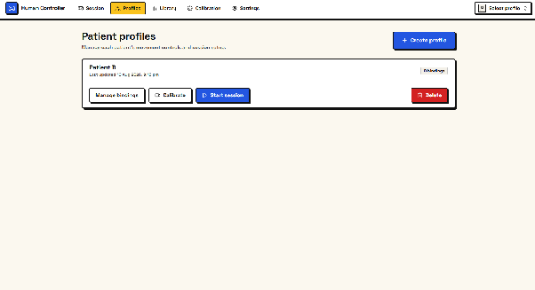
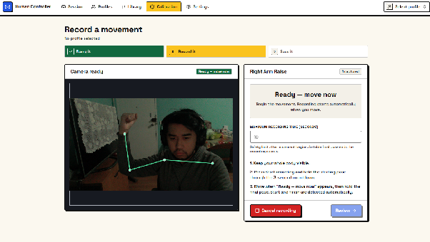
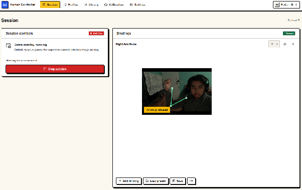

# Human Controller

**Play any keyboard game using your rehab exercises.** Human Controller is a desktop app that watches a patient through an ordinary webcam, recognises the movements their clinician has recorded, and turns each one into a key press in whatever game is running. No special hardware is needed.

Built as a 6-person UNSW COMP3900 capstone project (26T2) for a clinical client.

**Stack:** Python · PySide6 (Qt) · React + TypeScript · MediaPipe BlazePose · custom Dynamic Time Warping · native keyboard injection (macOS Quartz / Windows `SendInput`)

| Matching accuracy | Gesture → key latency | Stability |
| :---: | :---: | :---: |
| **93%** (target >90%) | **78 ms** (target <100 ms) | **0 crashes** in 20 sessions |

## My Contributions

- **Designed the gesture-matching algorithm.** I wrote a custom Dynamic Time Warping matcher instead of directly using a library, because existing libraries couldn't handle joints that dropped out of view. It uses an open-begin `symmetric2` step pattern, so a movement can start anywhere in a 150-frame live window. It normalises cost by path weight, so slow and fast repetitions score the same and one threshold works for every gesture and patient. It also runs four simple pre-filters (template range, amplitude, end pose and in-order coverage) that reject holding still, reversed movements and half-finished attempts before any DTW work is done.
- **Designed the smoothing strategy.** Each noisy signal gets its own filter. Match scores use a rolling mean that resets when the candidate gesture changes, which handles repeated key presses. The on-screen skeleton uses an alpha-beta smoother so the skeleton rendering is not jittery.
- **Major frontend contributions.** I also worked on the React + TypeScript UI (profiles, calibration and session pages).

## Screenshots

| Patient profiles | Recording a movement | Live session |
| :---: | :---: | :---: |
|  |  |  |

**How it works:**
1. The clinician creates a patient profile.
2. They record an exercise, such as "Right Arm Raise", with live skeleton tracking.
3. They bind that exercise to a key.
4. They start a session. A small always-on-top camera window sits over the game and presses the key each time the patient completes the movement.

## System Architecture


Camera frames go through a dedicated pose thread that processes one frame at a time and drops new frames while busy, which keeps latency bounded. MediaPipe BlazePose's 33 landmarks are reduced to 16, which are turned into 10 joint angles. These are matched against the stored 32-frame templates using DTW. A trigger controller then applies the threshold, smoothing and cooldown before a native key event is sent to the game. The React UI runs inside a Qt WebEngine view and talks to Python through WebChannel bridges. Profiles and gestures are stored as versioned JSON files that are written atomically.

# Download

## Windows

- [**Windows download**](https://github.com/unsw-cse-comp99-3900/capstone-project-26t2-3900-w18b-date/releases/download/latest/Human-Controller-Windows.zip)
  
## macOS

You can download the macOS app here:
[**macOS download**](https://github.com/unsw-cse-comp99-3900/capstone-project-26t2-3900-w18b-date/releases/download/latest/Human-Controller-macOS.zip)

when you try to open the macOS app, you might get a pop up that looks like this:


To resolve this, follow these instructions:


And click "Open Anyway"


# Developer Instructions

This repo combines:

- a React frontend in `frontend/`
- a PySide6 desktop shell in `app/`
- Python backend and pose/matching code in `backend/`
- development helpers in `devtools/`

## Repo Layout

```text
.
├── app/        # Desktop app, Qt bridges, camera/session logic, tests
├── backend/    # Pose estimation and matching engine code
├── devtools/   # Preview helpers and development-only Python modules
├── frontend/   # React + TypeScript UI
├── scripts/    # Runnable wrappers for preview and packaging workflows
└── Makefile    # Common commands
```

## How the Parts Fit Together

At runtime, the React app is loaded inside a Qt `QWebEngineView`.

- `frontend/` renders the UI and calls Python bridge objects through Qt WebChannel.
- `app/` owns the native window, camera lifecycle, overlays, profile loading, and bridge objects such as `sessionBridge`, `calibrateBridge`, and `profileBridge`.
- `backend/` contains the pose and matching code used by the desktop flow.
- `devtools/` contains preview-only helpers such as the local health-check server and backend process manager.

In local preview mode:

- Vite serves the frontend at `http://127.0.0.1:5173`
- the desktop app loads that URL instead of built files
- the desktop app also auto-starts the local backend helper

Important detail: camera pixels are not drawn by React. Calibration reports an
in-page viewport for the native Qt preview, while Session uses a separate
always-on-top picture-in-picture window.

## Setup

macOS / Linux:

```bash
python3 -m venv .venv
source .venv/bin/activate
pip install -r requirements.txt
pip install -r app/requirements.txt
pip install -r backend/requirements.txt
cd frontend
npm ci
npm run build
cd ..
```

Windows PowerShell:

```powershell
python3 -m venv .venv
.\.venv\Scripts\Activate.ps1
pip install -r requirements.txt
pip install -r app/requirements.txt
pip install -r backend/requirements.txt
cd frontend
npm ci
npm run build
cd ..
```

## Build the App

After following the setup instructions to finish the installation, you can build the desktop app:

macOS:

```bash
make macos-app
open "dist/Human Controller.app"
```

Windows Powershell:

```powershell
python -m PyInstaller run_app.spec --clean
dist/HumanController/"Human Controller".exe
```

`make macos-app` creates `dist/Human Controller.app`.

## Daily Development

Use this when you are actively working on the project and want the frontend, desktop app, and backend helper to run together:

```bash
make preview-local
```

This is the main integrated development workflow. It starts:

- the Vite dev server
- the desktop app
- the local backend helper

Frontend edits update live. Backend edits are auto-restarted by the preview script.

On Windows, if you do not use `make`:

```powershell
.\.venv\Scripts\python.exe scripts\preview_local.py
```

If you want more detail about the desktop shell itself, the Qt bridges, or app-specific notes, see [`app/README.md`](app/README.md).

### macOS Camera Note

On macOS, camera permission is tied to the real `.app` bundle identity.

If `make preview-local` cannot access the camera, build the app once first:

```bash
make macos-app
make preview-local
```

If camera access was previously denied:

```bash
tccutil reset Camera
```

### Checks

From the repo root:

```bash
make app-check
make backend-check
cd frontend && npm run lint
cd frontend && npm run typecheck
```

### Useful Commands

```bash
make preview-local   # full local preview flow
make macos-app       # build macOS desktop bundle
make app-check       # compile + test app/
make backend-check   # compile + test backend/
```
